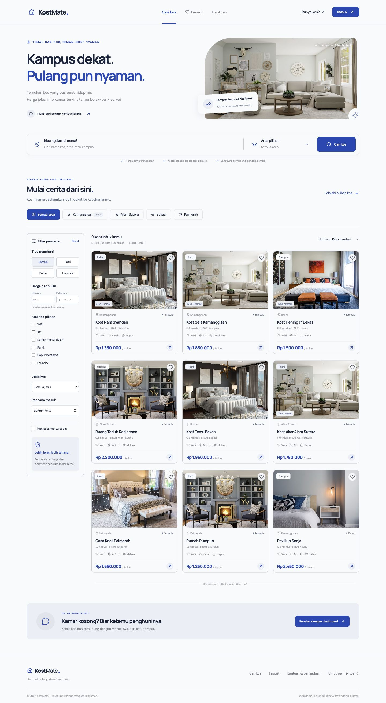

# KostMate — panduan demo paling gampang

KostMate adalah **prototype pencarian kos** memakai React, Python FastAPI, dan SQLite.
Ada pencarian kos, login/daftar, favorit, survei, pengaduan, dan dashboard pemilik.

> GitHub menyimpan kodenya. Untuk mencoba websitenya, unduh dan jalankan di laptop.
> Mengklik file di GitHub atau membuka `index.html` langsung belum menyalakan aplikasi.

## 1. Siapkan tiga aplikasi ini (sekali saja)

- **Node.js 22.12+ atau 24 LTS**: [unduh Node.js](https://nodejs.org/).
- **Python 3.11 atau lebih baru**: [unduh Python](https://www.python.org/downloads/). Di Windows, centang **Add Python to PATH** saat memasang.
- **Git**: [unduh Git](https://git-scm.com/downloads).

Selesai install? Tutup terminal, lalu buka terminal baru.
Terminal adalah tempat mengetik perintah: **Terminal** di Mac, **PowerShell** di Windows.

Ketik satu per satu:

```sh
node --version
npm --version
```

Kalau keluar nomor versi, Node dan npm sudah dikenali. Script persiapan akan mencari Python otomatis.
Kalau tertulis `not recognized` atau `command not found`, install aplikasi yang disebut, lalu buka ulang terminal.

## 2. Ambil project

Ketik satu baris, tekan Enter, lalu lanjut baris berikutnya:

```sh
git clone https://github.com/Pence420/KostMate.git
cd KostMate
```

Kalau sudah punya folder KostMate, buka terminal di folder itu. Untuk memperbarui kode tanpa menimpa perubahan lokal:

```sh
git pull --ff-only
```

**Alternatif tanpa Git:** di halaman repo klik **Code → Download ZIP**, ekstrak ZIP, lalu buka terminal di folder hasil ekstrak. Folder yang benar berisi `package.json`, `frontend`, dan `backend`.

## 3. Siapkan project

```sh
npm run setup
```

Tunggu sampai muncul **SIAP!**. Perintah ini menyiapkan Python lokal, memasang kebutuhan backend dan frontend, lalu membuat tampilan website.

**Internet dibutuhkan untuk langkah ini.** Jangan tutup terminal selama instalasi. Kalau gagal karena internet putus, sambungkan internet lalu jalankan perintah yang sama lagi.

## 4. Nyalakan website

```sh
npm start
```

Tunggu tulisan `Application startup complete`. Buka alamat ini di browser:

**[http://127.0.0.1:8000](http://127.0.0.1:8000)**

Sekarang **website dan backend menyala bersama dari satu terminal**. Tidak perlu menyalakan React dan Python terpisah untuk demo.

- Biarkan terminal ini terbuka selama demo.
- Untuk berhenti, tekan **Ctrl+C** di terminal.
- Besok ingin membuka lagi? Masuk folder KostMate dan ketik `npm start`.
- Setelah mendapat update dari GitHub, jalankan `npm run setup` lagi sebelum `npm start`.
- Jika port 8000 sudah dipakai, hentikan server lama atau jalankan `npm start -- --port 8001`, lalu buka `http://127.0.0.1:8001`.

## 5. Datanya ada dari mana?

**Tidak perlu mengunduh database atau mengisi SQL.** Saat pertama menyala, backend membuat file `backend/kostmate.db`, **9 listing kos**, **2 akun demo**, **4 catatan penghuni**, dan contoh pembayaran.

File database setiap laptop berbeda dan tidak diunggah ke GitHub. Jadi perubahan di laptopmu tidak otomatis terlihat di laptop teman. Ini normal untuk prototype lokal.

Data tetap tersimpan setelah server dimatikan. Menyalakan ulang tidak menggandakan listing dan tidak mengembalikan perubahanmu ke awal. Kalau kamu mendaftar akun pemilik baru, dashboard akun itu kosong sampai kamu menambahkan kos sendiri. Untuk melihat contoh properti yang sudah tersedia, gunakan akun owner demo di bawah.

Kalau pencarian tampak kosong, klik **Reset** pada filter. Kalau semua data hilang, lihat bagian bantuan.

## 6. Masuk sebagai pencari kos

1. Klik **Masuk** di pojok atas. Pada HP, tombol navigasi bergambar tiga garis.
2. Di bagian **Coba dengan akun demo**, klik **Pencari kos**. Email dan password otomatis terisi.
3. Klik **Masuk** sekali lagi untuk mengirim form.
4. Cari kos atau pilih area. Coba filter **Putri**, harga, atau fasilitas **AC**.
5. Klik nama kos untuk membuka foto, harga, fasilitas, peraturan, dan biaya tambahan.
6. Klik ikon **hati / Simpan**. Buka **Favorit** untuk melihat hasil simpanan.
7. Di detail kos yang tersedia, klik **Ajukan jadwal survei**. Pilih hari ini atau tanggal mendatang, isi pesan, lalu kirim.
8. Buka **Bantuan → Buat pengaduan**. Pilih kos, isi judul dan cerita kendala, lalu kirim.
9. Klik **Keluar**. Pada HP, buka menu akun dengan mengetuk lingkaran inisial nama.

| Peran       | Email                 | Password       |
| ----------- | --------------------- | -------------- |
| Pencari kos | `nadia@kostmate.demo` | `Kostmate123!` |
| Pemilik kos | `owner@kostmate.demo` | `Kostmate123!` |

Huruf besar/kecil password harus sama. Tidak perlu akun Google, email sungguhan, OTP, atau konfirmasi email untuk demo ini.

## 7. Masuk sebagai pemilik kos

1. Keluar dulu dari akun pencari kos.
2. Klik **Masuk → Pemilik kos → Masuk**.
3. Klik **Dashboard** atau **Punya kos?**.
4. Buka **Permintaan survei**. Pengajuan yang dibuat tadi muncul di sini.
5. Buka **Properti saya → Kelola kos** pada kos yang dipakai tadi.
6. Ubah **Kamar kosong**, misalnya dari `3` menjadi `2`, lalu klik **Simpan perubahan**. Jumlah tidak boleh negatif atau melebihi total kamar.
7. Buka detail kos atau pencarian. Jumlah kamar sudah berubah. Halaman pencarian yang sedang terbuka ikut diperbarui dalam sekitar 2 detik.
8. Buka **Pengaduan**, lalu ubah laporan tadi dari **Baru** ke **Diproses** atau **Selesai**.
9. Buka **Penghuni & pembayaran**. Pada penghuni yang belum bayar, klik **Catat lunas** dan konfirmasi. Ini hanya catatan demo, tidak memindahkan uang.
10. Coba **Tambah kos** untuk listing baru, atau **Tambah penghuni** untuk catatan penghuni baru.

**Catatan:** penghuni dan jumlah kamar kosong dikelola terpisah. Setelah mencatat penghuni baru, ubah jumlah kamar kosong melalui **Kelola kos** juga. Total hunian dihitung dari jumlah kamar; pendapatan dihitung dari pembayaran penghuni yang tercatat pada bulan berjalan.

## 8. Mau membuat akun sendiri?

1. Klik **Masuk → Daftar gratis**.
2. Isi nama, email berformat `nama@contoh.com`, dan password minimal 8 karakter.
3. Pilih **Mencari kos** atau **Mengelola kos**.
4. Klik **Buat akun**. Kamu langsung masuk.

Email yang sama tidak bisa didaftarkan dua kali. Pemilik hanya bisa mengedit kos miliknya sendiri. Akun pencari kos tidak mendapat akses dashboard owner.

## 9. Urutan presentasi singkat

Sebelum presentasi, jalankan pemeriksaan otomatis dari terminal lain:

```sh
npm run check
```

Kalau berhasil, bagian terakhir menampilkan **DEMO OK**. Pemeriksaan memakai database sementara sehingga tidak mengubah data demomu. Setelah itu jalankan `npm start` jika belum menyala.

Urutan yang enak dipresentasikan:

**Cari/filter → detail → login pencari → favorit → ajukan survei → pengaduan → keluar → login owner → lihat survei → ubah kamar → tanggapi pengaduan → catat pembayaran.**

## 10. Kalau ada masalah

| Yang terlihat                                     | Yang harus dilakukan                                                                                                                      |
| ------------------------------------------------- | ----------------------------------------------------------------------------------------------------------------------------------------- |
| `Missing script` / `package.json` tidak ditemukan | Terminal belum di folder KostMate. Ketik `cd KostMate`, atau buka terminal di folder yang berisi `package.json`.                          |
| Node/Python tidak ditemukan                       | Install aplikasi pada langkah 1. Windows: centang Python PATH. Buka ulang terminal, lalu ulangi setup.                                    |
| PowerShell menolak `npm.ps1`                      | Gunakan `npm.cmd run setup` dan `npm.cmd start`, atau gunakan Command Prompt. Tidak perlu mengubah kebijakan keamanan PowerShell.         |
| Install gagal / koneksi terputus                  | Cek internet, lalu ulangi `npm run setup`. Perhatikan pesan error pertama di terminal.                                                    |
| Website tidak bisa dibuka                         | Pastikan `npm start` masih menyala dan sudah muncul `Application startup complete`. Gunakan alamat yang dicetak terminal.                 |
| Port 8000 sudah dipakai                           | Ctrl+C di server lama, atau gunakan `npm start -- --port 8001`. Buka alamat dengan port yang sama.                                        |
| Data/login gagal di alamat 5173                   | Untuk demo, gunakan alamat **8000** dari `npm start`. Jangan hanya menyalakan frontend.                                                   |
| Data kos kosong                                   | Reset filter. Cek terminal server. Pastikan `KOSTMATE_SEED` tidak diatur ke `0` jika ingin contoh data.                                   |
| Owner baru tidak punya kos                        | Itu benar: listing contoh dimiliki `owner@kostmate.demo`. Masuk dengan akun tersebut atau klik Tambah kos pada akunmu sendiri.            |
| Akun demo gagal masuk                             | Pastikan memakai backend/database yang sama, lalu coba `npm run setup` dan restart server. Akun yang sudah diubah tidak direset otomatis. |
| Survei ditolak                                    | Tanggal harus hari ini atau mendatang dan kos harus punya kamar kosong.                                                                   |
| Foto/font tidak muncul                            | Foto Unsplash dan font Google membutuhkan internet. Database dan akun dibuat lokal.                                                       |
| Perubahan teman tidak muncul                      | Setiap laptop menyimpan database sendiri. Untuk berbagi perubahan, gunakan satu server yang sama; versi ini belum dihosting bersama.      |
| Halaman GitHub tidak menampilkan aplikasi         | Repo ini source code. Ikuti langkah 1–4; GitHub Pages saja tidak menjalankan backend Python.                                              |

**Ingin mengulang data demo dari awal?** Hentikan server dahulu dengan Ctrl+C. Simpan salinan `backend/kostmate.db`, lalu **ganti nama** file itu menjadi `kostmate-backup.db`. Jalankan `npm start`; database demo baru akan dibuat. Data lama tetap ada di file backup. Jika memakai `KOSTMATE_DB` khusus, lokasi filenya mengikuti variabel itu.

## Batas prototype

Semua listing, alamat, jarak, foto, dan penghuni contoh adalah ilustrasi. Survei merupakan pengajuan jadwal, bukan booking atau konfirmasi otomatis. Pencarian tanggal masuk mengecek tanggal mulai ketersediaan, bukan kalender reservasi.

Pembayaran hanya pencatatan manual. Tidak ada transfer uang, subscription, OTP, pengiriman email, atau pengingat WhatsApp otomatis. Kontak WhatsApp muncul setelah pemilik mengisi nomor dengan format `62812...` lewat Kelola kos. Nomor demo kosong agar tidak menghubungi orang sungguhan.

## Untuk yang ingin mengembangkan kode

- `npm run dev` juga menjalankan mode demo satu server, seperti `npm start`.
- `npm run backend`: backend dengan reload di port 8000.
- `npm run dev:frontend`: Vite di port 5173; **backend wajib menyala**. Gunakan host `127.0.0.1` secara konsisten agar sesi login tidak terpisah dengan `localhost`.
- `npm test`: tes API dengan database sementara.
- `npm run build`: pemeriksaan TypeScript dan build React.
- `npm run check`: tes API, build, dan simulasi demo dari database baru.
- API docs tersedia di `http://127.0.0.1:8000/docs` saat server menyala.

Dependency Python dikunci di `backend/requirements.lock.txt`; dependency React di `frontend/package-lock.json`. Script setup mendukung susunan folder virtual environment Windows dan Mac/Linux. Pengujian aktual dilakukan pada macOS; Windows belum diuji langsung.

| Variabel opsional | Default               | Kegunaan                                                           |
| ----------------- | --------------------- | ------------------------------------------------------------------ |
| `KOSTMATE_DB`     | `backend/kostmate.db` | Lokasi database                                                    |
| `KOSTMATE_SEED`   | `1`                   | `0` menonaktifkan pembuatan data contoh                            |
| `COOKIE_SECURE`   | `0`                   | Gunakan `1` hanya pada server HTTPS; localhost HTTP memerlukan `0` |

Prototype dijalankan pada satu proses server. Hosting publik membutuhkan konfigurasi HTTPS, akun/data non-demo, pembatasan login, backup, dan event bersama jika memakai beberapa worker.


